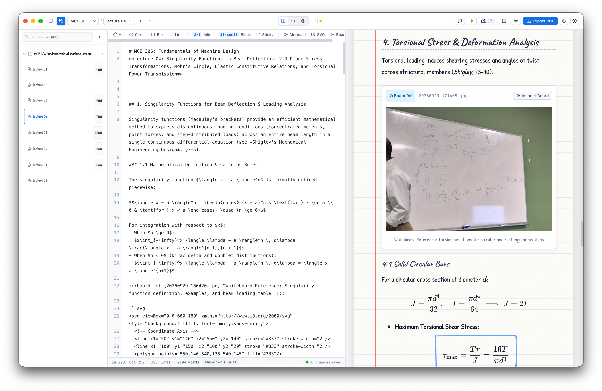

# 🖋️ LectNote

> Transform whiteboard photos and lecture drafts into publication-grade, interactive study notes and vector PDFs.

`LectNote` is a local Node.js studio built for engineering and STEM lectures. It pairs **KaTeX** math, **Rough Notation** hand-drawn annotations, **AI-reconstructed code diagrams** (Mermaid & SVG), and an **interactive whiteboard reference inspector**, with a seamless toggle between **Ruled Notebook** and **Academic View**.



---

## ✨ Features

- **📓 Ruled Notebook Theme (Default):** Warm paper texture, red margin line, handwritten fonts (`Caveat`, `Patrick Hand`), tilted sticky notes with push-pins, and organic sketches.
- **🎓 Academic View Theme:** Formal IEEE / Springer publication aesthetic, high-contrast serif/sans-serif typography (`Newsreader`, `Inter`), and structured theorem callout boxes.
- **📐 AI-Reconstructed Code Diagrams:**
  - **Mermaid:** Workflows, phase transitions, and state algorithms.
  - **Direct SVG:** Clean 2D phase diagrams, coordinate axes, and physical models.
- **📷 Whiteboard Photo Drawer & Lightbox:**
  - Slide-out drawer displaying all original lecture photos for the current topic.
  - Deep zoom and pan lightbox to verify formulas, indices, and handwritten curves against the professor's board.
- **🤖 Selectable Multimodal AI Ingestion:**
  - **Google Gemini 3.8 Flash:** Native high-resolution batch photo processing.
  - **DeepSeek v4.1 Flash:** High-speed visual reasoning.
  - **Custom OpenAI-Compatible:** Connect to local vLLM, Ollama, LM Studio, or OpenRouter.
  - **Manual Mode:** Skip AI; write or paste Markdown directly while linking board photos.
- **🔍 Sidebar Explorer & Global Search:**
  - Collapsible course tree with lecture counts and photo badges (`⌘B` / `Ctrl+B`).
  - Instant full-text note and formula search (`⌘K` / `Ctrl+K`) with highlighted snippets.
- **💡 In-App AI Study Assistant & Tutor:**
  - Per-lecture conversational tutoring drawer (`⌘J` / `Ctrl+J`) answering concept questions and deriving formulas with KaTeX.
  - Interactive prompt chips (Key Takeaways, Explain Formulas, Practice Quiz).
  - 1-click **Add to Notes** button to append assistant derivations directly into your Markdown.
  - Persistent per-lecture chat history (`chat_history.json`).
- **🔌 Model Context Protocol (MCP) Server:**
  - Built-in MCP stdio server (`npm run mcp` or `node bin/lectnote-mcp.js`).
  - Zero-API-cost external integration: connect your existing Claude Desktop, Cursor, or Antigravity agents directly to your notes, query lectures, append study takeaways, and inject Q&As into the app!
- **⌨️ Enhanced Code & Markdown Editor:**
  - Synchronized line numbers gutter with wrapped line support and line jumping.
  - Auto-closing pairs (`$`, `()`, `[]`, `{}`, `""`, `''`, ```` ` ````) with overtyping and backspace deletion.
  - Smart list continuations (unordered `- `, `* `, ordered `1. `, and checkboxes `- [ ] `) with clean exit on empty Enter.
  - Multi-line Tab indent and Shift+Tab outdent.
  - 2-second debounced auto-save with unsaved changes guards.
- **🖨️ Vector PDF Export & Print:**
  - Native Electron vector PDF export via Chromium `webContents.printToPDF()` with zero binary dependencies.
  - Print-optimized CSS (`@media print`) preventing page breaks across equations and sticky notes.
  - Instant **Print View** (browser native print sheet with 1-click Save as PDF).

---

## 🚀 Quick Start

### 1. Install & Launch
```bash
# Clone and enter directory
git clone https://github.com/Berikai/lectnote.git
cd lectnote

# Install dependencies
npm install

# Run automated test suite
npm test

# Start local web studio
npm start
```

Open your browser at **[http://localhost:3000](http://localhost:3000)**.

### 2. Standalone Desktop App (Electron)
Launch LectNote as a native standalone desktop app with custom workspace selection:

```bash
# Launch Desktop Studio
npm run electron

# Open settings: ⌘, (macOS) or Ctrl+, (Windows/Linux)
# Choose any folder in your file system for your notes
```

> [!NOTE] macOS Community Release & Gatekeeper
> Because LectNote Studio is an open-source community distribution without a paid Apple Developer certificate, macOS Gatekeeper may display a security alert when opening the downloaded `.dmg` or `.app` for the first time. To allow it to run:
> ```bash
> xattr -cr "/Applications/LectNote Studio.app"
> ```
> Or right-click / Control-click the app icon in Finder and choose **Open**.

### 3. Model Context Protocol (MCP) Server Setup
Connect LectNote to **Claude Desktop**, **Cursor**, or **Antigravity** as an MCP server.

Add this entry to your `claude_desktop_config.json`:
```json
{
  "mcpServers": {
    "lectnote": {
      "command": "node",
      "args": ["<PATH_TO_CLONED_REPO>/bin/lectnote-mcp.js"]
    }
  }
}
```
> [!TIP] Workspace Auto-Discovery
> Replace `<PATH_TO_CLONED_REPO>` with your cloned repository directory (e.g. `/Users/berikai/Repositories/lectnote/bin/lectnote-mcp.js`).
> You do **not** need to configure your notes path — the MCP server automatically detects your Desktop app workspace from `~/Library/Application Support/lectnote/settings.json` or `~/Documents/LectNote/lectures`. (Optionally, pass `--dir=/custom/path` or set `LECTURES_DIR`).

Now you can ask Claude or Cursor:
> *"Summarize my lecture notes on Raft Consensus from LectNote and add 3 practice quiz questions into my notes."*

### 4. Build Desktop Application Installers
```bash
# Generate app icons (icon.icns, icon.ico, icon.png)
npm run icons

# Test packaged bundle
npm run electron:pack

# Build installer for current OS
npm run electron:build

# Specific OS targets
npm run electron:build:mac     # macOS .dmg & .zip
npm run electron:build:win     # Windows .exe (NSIS & portable)
npm run electron:build:linux   # Linux AppImage & .deb
```

---

## ⌨️ Keyboard Shortcuts

| Shortcut | Action |
| :--- | :--- |
| `⌘S` / `Ctrl+S` | Save notes immediately |
| `⌘B` / `Ctrl+B` | Toggle Sidebar Explorer |
| `⌘K` / `Ctrl+K` | Focus Global Notes Search |
| `⌘J` / `Ctrl+J` | Toggle AI Study Assistant / Tutor |
| `⌘,` / `Ctrl+,` | Open Workspace Settings |
| `Tab` / `Shift+Tab` | Indent / Outdent selected lines |
| `Esc` | Close drawers, modals, or lightbox |

---

## 📝 Markdown Syntax Cheat Sheet

| Syntax | Description | Example |
| :--- | :--- | :--- |
| `==text==` | Hand-drawn highlighter | `==Arrhenius relationship==` |
| `[formula]{.circle}` | Red hand-drawn circle | `[\sigma_f = \sqrt{2E\gamma/\pi a}]{.circle}` |
| `[definition]{.box}` | Blue hand-drawn box | `[J = -D \frac{dC}{dx}]{.box}` |
| `[warning]{.underline}` | Orange hand-drawn underline | `[valid for isotropic diffusion]{.underline}` |
| `> [!note] Title` | Pinned Professor Sticky Note | `> [!note] Exam Insight`<br>`> Interstitial activation energy is lower.` |
| `> [!warning] Title` | Warning / Pitfall Callout | `> [!warning] Units`<br>`> Always convert Celsius to Kelvin.` |
| `:::board-ref [photo.svg] "Caption" :::` | Interactive Whiteboard Reference | Links to photo drawer & lightbox |
| ```` ```mermaid ```` | Vector Flowchart / Sequence | State transitions, mechanisms |
| ```` ```svg ```` | Vector Diagram | Physical curves, coordinate models |

---

## 📂 Workspace Structure

Notes are stored as standard Git/Obsidian-compatible directories:

```
lectures/
├── MCE306-MaterialsScience/
│   └── lecture-03-diffusion-fick/
│       ├── notes.md                 # Raw Markdown source
│       ├── chat_history.json        # Per-lecture AI tutor history
│       ├── photos/                  # Original whiteboard photos
│       │   └── diffusion_membrane.svg
│       └── lecture-03_notes.pdf     # Exported vector PDF
└── CS301-Algorithms/
    └── lecture-04-graph-traversal/
        ├── notes.md
        ├── chat_history.json
        └── photos/
```


