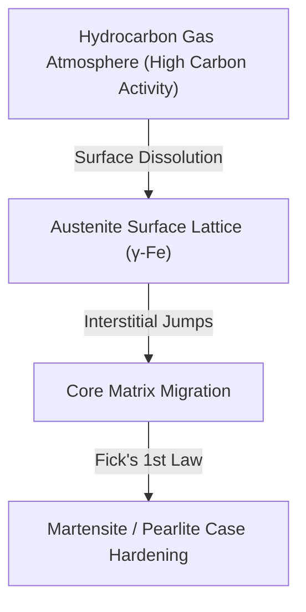

# MCE 306: Diffusion in Solids & Fick's Laws

> [!note] Midterm Key Insight
> In crystalline materials, atomic migration is thermally activated. Notice that activation energy for interstitial diffusion ($Q_{inter}$) is always **significantly lower** than vacancy diffusion ($Q_{sub}$) because interstitial solute atoms (e.g., Carbon in Iron) are much smaller than solvent host atoms!

## 1. Physical Mechanism & Arrhenius Behavior

Atoms migrate through vacancies or interstitial lattice sites under thermal agitation. The temperature dependency of the diffusion coefficient obeys an ==Arrhenius relationship==:

$$D = D_0 \exp\left(-\frac{Q_d}{R T}\right)$$

Where:
* $D$: Diffusion coefficient ($\text{m}^2/\text{s}$)
* $D_0$: Temperature-independent pre-exponential factor ($\text{m}^2/\text{s}$)
* $Q_d$: Activation energy for diffusion ($\text{J}/\text{mol}$ or $\text{eV}/\text{atom}$)
* $R$: Universal gas constant ($8.314\ \text{J}/(\text{mol}\cdot\text{K})$)
* $T$: Absolute temperature ($\text{K}$)

> [!warning] Exam Pitfall
> Always convert Celsius to Kelvin ($T = T_C + 273.15$). Failing to convert will yield exponential scaling errors of orders of magnitude!

---

## 2. Steady-State Diffusion: Fick's First Law

When the concentration gradient does not vary with time ($\frac{\partial C}{\partial t} = 0$), diffusion flux $J$ moves down the concentration gradient:

[$J = -D \frac{dC}{dx}$]{.box}

* $J$: Diffusion flux ($\text{kg}/(\text{m}^2\cdot\text{s})$ or $\text{atoms}/(\text{m}^2\cdot\text{s})$)
* $\frac{dC}{dx}$: Concentration gradient ($\text{kg}/\text{m}^4$)
* The negative sign signifies that atomic flux occurs from regions of [high concentration to low concentration]{.underline}.

:::board-ref [diffusion_membrane.svg] "Whiteboard Reference: Steady-state linear concentration profile across membrane" :::

### Vector Mechanism Diagram
Here is the reconstructed atomic migration workflow during surface gas carburization:



---

## 3. Physical Concentration Profile & Geometric Model

Below is the steady-state diffusion curve through a thin metallic membrane of thickness $\Delta x$:

```svg
<svg viewBox="0 0 500 240" xmlns="http://www.w3.org/2000/svg" style="background:#ffffff; border-radius:6px; font-family:'Inter', sans-serif;">
  <!-- Grid Lines -->
  <line x1="60" y1="20" x2="60" y2="190" stroke="#94a3b8" stroke-width="2" />
  <line x1="60" y1="190" x2="450" y2="190" stroke="#94a3b8" stroke-width="2" />

  <!-- Membrane Boundaries -->
  <line x1="140" y1="20" x2="140" y2="190" stroke="#cbd5e1" stroke-dasharray="4" stroke-width="2" />
  <line x1="360" y1="20" x2="360" y2="190" stroke="#cbd5e1" stroke-dasharray="4" stroke-width="2" />

  <!-- Concentration Curve -->
  <line x1="140" y1="50" x2="360" y2="150" stroke="#2563eb" stroke-width="3.5" />
  <circle cx="140" cy="50" r="5" fill="#ef4444" />
  <circle cx="360" cy="150" r="5" fill="#ef4444" />

  <!-- Flux Arrow -->
  <path d="M 220 80 L 280 80 M 270 73 L 282 80 L 270 87" fill="none" stroke="#dc2626" stroke-width="3" />
  <text x="235" y="70" font-size="14" fill="#dc2626" font-weight="bold">Flux J &rarr;</text>

  <!-- Labels -->
  <text x="14" y="105" font-size="13" fill="#475569" transform="rotate(-90 14,105)">Concentration C</text>
  <text x="210" y="220" font-size="13" fill="#475569">Position x (Thickness &Delta;x)</text>
  <text x="100" y="45" font-size="13" fill="#0f172a" font-weight="600">C_A (High)</text>
  <text x="370" y="155" font-size="13" fill="#0f172a" font-weight="600">C_B (Low)</text>
</svg>
```

---

## 4. Non-Steady-State: Fick's Second Law

When concentration evolves over time ($\frac{\partial C}{\partial t} \neq 0$):

$$\frac{\partial C}{\partial t} = D \frac{\partial^2 C}{\partial x^2}$$

For semi-infinite solid boundary conditions ($C_s$ constant at surface, $C_0$ initial interior), the analytical solution uses the Gaussian error function:

[$\frac{C_x - C_0}{C_s - C_0} = 1 - \text{erf}\left(\frac{x}{2\sqrt{Dt}}\right)$]{.circle}

> [!tip] Exam Rule of Thumb
> The characteristic diffusion penetration distance scales as:
> $$x \approx \sqrt{Dt}$$
> To double the case-hardening depth, you must quadruple the processing time ($t \propto x^2$).
